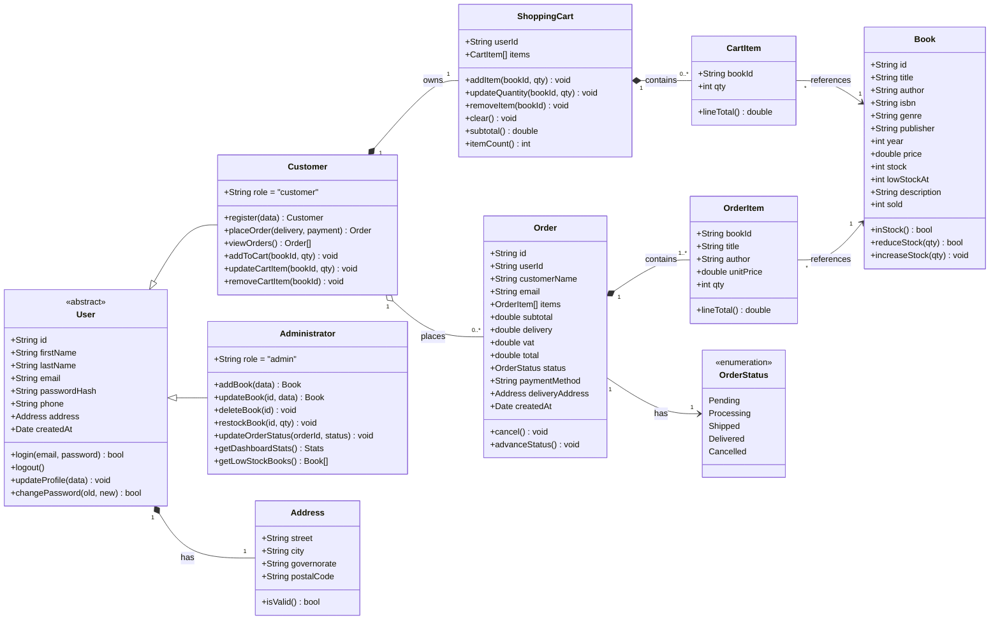

# SA Online Bookstore — UML Diagrams

Two diagrams: a **use-case diagram** describing the behaviour visible to the actors, and a
**class diagram** describing the data model. Both use Mermaid and render on GitHub, GitLab,
VS Code (Markdown preview) and <https://mermaid.live>.

---

## 1. Use-Case Diagram

Mermaid's flowchart has no dedicated UML actor symbol, so the actors use the built-in `person`
shape (a circular head above a rounded body), which reads like a classic stick-figure actor.
Use cases sit inside the system boundary and dashed arrows are `«include»` relationships (a use
case always performs the target use case as part of its own behaviour).

> Requires Mermaid **11.17+**. GitHub's Markdown renderer supports it; if a local preview shows
> a syntax error, update your Mermaid preview extension.

```mermaid
flowchart LR
    C@{ shape: person, label: "Customer" }
    A@{ shape: person, label: "Administrator" }

    subgraph SYS["SA Online Bookstore"]
        direction TB
        LOGIN(["Log in / log out"])

        subgraph CUST["Customer use cases"]
            direction TB
            R(["Register account"])
            B(["Browse catalogue"])
            S(["Search books by title or author"])
            D(["View book details"])
            AC(["Add book to cart"])
            CU(["Update / remove cart line"])
            CO(["Checkout and place order"])
            MO(["View order history"])
            MA(["Manage profile and password"])
        end

        subgraph ADM["Administrator use cases"]
            direction TB
            DB(["View dashboard KPIs"])
            MB(["Manage books (CRUD)"])
            INV(["Manage inventory and restock"])
            AO(["View, search and filter orders"])
            ADV(["Advance order status"])
            CAN(["Cancel order"])
        end

        subgraph SUPPORT["Included system behaviour"]
            direction TB
            ST(["Check stock availability"])
            VT(["Calculate VAT and delivery"])
            RS(["Restore stock"])
        end
    end

    C --- R
    C --- LOGIN
    C --- B
    C --- S
    C --- D
    C --- AC
    C --- CU
    C --- CO
    C --- MO
    C --- MA

    A --- LOGIN
    A --- DB
    A --- MB
    A --- INV
    A --- AO
    A --- ADV
    A --- CAN

    AC -.->|«include»| ST
    CO -.->|«include»| ST
    CO -.->|«include»| VT
    CAN -.->|«include»| RS

    classDef actor fill:#f3e9d6,stroke:#96601f,stroke-width:2px,color:#2a1c10;
    classDef usecase fill:#fcf6e8,stroke:#2f6b5c,color:#2a1c10;
    classDef support fill:#f7efdd,stroke:#a87313,stroke-dasharray:4 3,color:#2a1c10;

    class C,A actor;
    class R,LOGIN,B,S,D,AC,CU,CO,MO,MA,DB,MB,INV,AO,ADV,CAN usecase;
    class ST,VT,RS support;

    style SYS fill:#fffaf0,stroke:#96601f,stroke-width:1.5px
    style CUST fill:transparent,stroke:#c39b3c,stroke-dasharray:3 3
    style ADM fill:transparent,stroke:#1f4e79,stroke-dasharray:3 3
    style SUPPORT fill:transparent,stroke:#a87313,stroke-dasharray:3 3
```

### Actors

| Actor | Goals | Entry points |
|---|---|---|
| **Customer** | Find books, manage a cart, place orders and track them, maintain an account. | `Customer's/Login.html`, `Index.html`, `Book_Catalog.html`, `Book_details.html`, `Cart.html`, `Checkout.html`, `My_Orders.html`, `Account.html` |
| **Administrator** | Keep the catalogue and stock healthy, monitor sales, and move orders through their lifecycle. | `Admin's/Dashboard.html`, `Book_Catalog.html`, `Book_details.html`, `Inventory.html`, `Orders.html` |

### Use-case catalogue

| ID | Use case | Actor | Requirement | Includes / notes |
|---|---|---|---|---|
| UC1 | Register account | Customer | R1 | Unique-email validation; new accounts always get the `customer` role. |
| UC2 | Log in / log out | Customer, Administrator | R2 | Session persists in `sab.session`; login redirects by role. |
| UC3 | Browse catalogue | Customer | R4, R6 | Responsive grid; also the home page's featured section. |
| UC4 | Search books by title or author | Customer | R5 | Live, case-insensitive, combined with the genre filter. |
| UC5 | View book details | Customer | R7 | Description, ISBN, publisher, year, genre, price, stock. |
| UC6 | Add book to cart | Customer | R8 | Includes UC17. Adding the same title increases quantity. |
| UC7 | Update / remove cart line | Customer | R9, R11 | Cart persists per customer; totals recalculate immediately. |
| UC8 | Checkout and place order | Customer | R12, R13 | Includes UC17 and UC18; creates `ORD-…`, clears the cart, shows confirmation. |
| UC9 | View order history | Customer | R15 | Expandable details and the R14 status timeline. |
| UC10 | Manage profile and password | Customer | R16 | Edit name, phone, address; change password. |
| UC11 | View dashboard KPIs | Administrator | R17 | Revenue, orders, title count, low-stock count, recent orders, best sellers. |
| UC12 | Manage books (CRUD) | Administrator | R18 | Create, read, update, delete, with form validation. |
| UC13 | Manage inventory and restock | Administrator | R19 | Quick/custom restock; low-stock (< 5) and out-of-stock alerts. |
| UC14 | View, search and filter orders | Administrator | R20 | Filter by status, search by order number, customer or email. |
| UC15 | Advance order status | Administrator | R14 | `Pending → Processing → Shipped → Delivered`. |
| UC16 | Cancel order | Administrator | R14, R20 | Includes UC19; cancellation is admin-only in this scope. |
| UC17 | Check stock availability | System | R10 | Blocks over-stock adds/orders; warns in cart and at checkout. |
| UC18 | Calculate VAT and delivery | System | R12 | 14% VAT, `L.E 50` delivery, free over `L.E 750`. |
| UC19 | Restore stock | System | R20 | Cancelled orders return their reserved copies to the catalogue. |

### Use-case notes

- **Access control (R3):** every use case except UC1–UC5 requires an authenticated session.
  Customer pages use `data-guard="customer"` and admin pages use `data-guard="admin"`; the guards
  in `assets/js/app.js` redirect to Login or to the correct area.
- **Cancellation scope:** customers cannot cancel an order; they only see the updated status in
  UC9. UC16 is performed by an administrator, and UC19 keeps stock accurate.
- **UC17, UC18 and UC19** are not separate pages — they are behaviour inside the store layer that
  the visible use cases always perform, hence `«include»`.

---

## 2. Class Diagram

Matches the classes suggested in the brief (`Customer`, `Book`, `ShoppingCart`, `CartItem`,
`Order`, `OrderItem`) plus `Administrator`, `User`, `Address` and the `OrderStatus` enumeration.



---

## 3. Class relationship notes

| Relationship | Meaning |
|---|---|
| `User <|-- Customer / Administrator` | Inheritance. Both actors share login, profile and password behaviour; only their permissions differ. |
| `Customer 1 *-- 1 ShoppingCart` | Each customer has exactly one cart, destroyed with the account. |
| `ShoppingCart 1 *-- 0..* CartItem` | A cart holds zero or more lines; a line exists only inside its cart. |
| `CartItem * --> 1 Book` | Association: many cart lines may point at the same book. The cart stores `bookId` + `qty`, not a copy of the book. |
| `Customer 1 o-- 0..* Order` | Aggregation: orders outlive the cart and are kept as history. |
| `Order 1 *-- 1..* OrderItem` | Composition: order lines cannot exist without their order. |
| `OrderItem * --> 1 Book` | Association, but **unit price and title are snapshotted** into the line so later price edits don't rewrite old orders. |
| `Order 1 --> 1 OrderStatus` | Status is an enumeration so only valid transitions are possible. |
| `User 1 *-- 1 Address` | Composition, value object. The order keeps its own copy so editing the profile never changes historical deliveries. |

## 4. Mapping to the localStorage store

| Class | Storage | Notes |
|---|---|---|
| `User` / `Customer` / `Administrator` | `sab.users` | One collection, `role` field discriminates |
| `Book` | `sab.books` | CRUD by administrator |
| `ShoppingCart` + `CartItem` | `sab.carts` | `{ userId: [{ bookId, qty }] }` |
| `Order` + `OrderItem` | `sab.orders` | Items embedded in the order (snapshot) |
| `OrderStatus` | enum in `store.js` | `Pending`, `Processing`, `Shipped`, `Delivered`, `Cancelled` |
| `Address` | embedded in `user.address` and `order.delivery` | copy on order creation |
